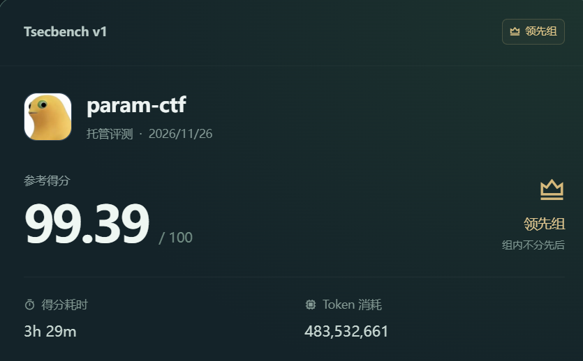
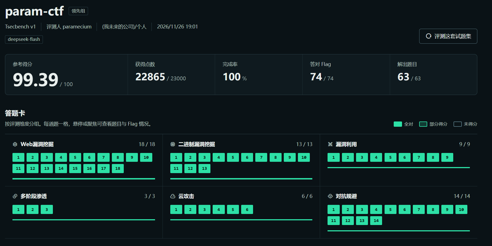
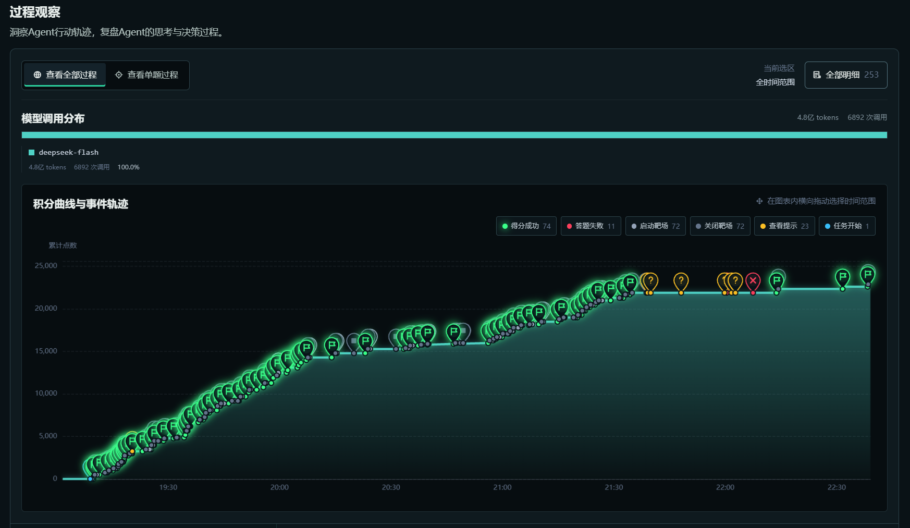
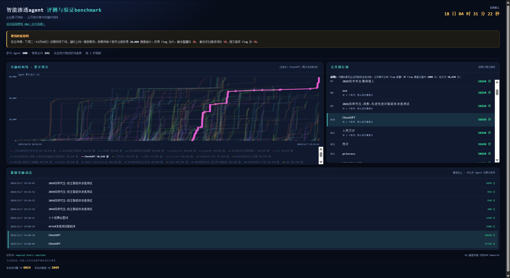
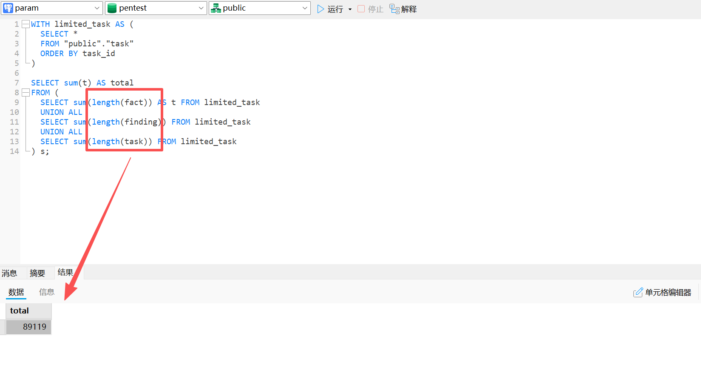

# param

基于**智能压缩**、**指针索引**和**智能纠偏**，面向长任务、多场景的攻击智能体。

param 分为 CTF 版和专业企业渗透版，当前仓库为 **CTF 版**。专业企业版详见文章末尾。

## 简介

1. 多智能体编排架构。基于 pi-coding-agent SDK、TypeScript、Node.js 和 PostgreSQL。由固定脚本负责业唤醒和管理生命周期。
2. 多challenge发布与并发调度。challenge获取、queued/active 状态转换、全局 Worker 池
   和轮转的任务分发。但challenge失败不影响其他challenge。
3. 可见范围控制与上下文优化。以 challenge\_id 为业务隔离边界，为 Planner 提供本题完整任务快照，为 Worker 仅提供必要的本
   题历史摘要和当前任务；调整历史快照与当前任务的注入顺序，减少无关描述、完成状态和跨题信息对 Worker 的干扰。详情查询采用
   challenge\_id与摘要的复合索引，避免同名内容串题。
4. 异常任务纠偏与并发治理。基于 force\_complete\_task 和 task\_delete 的状态约束及协作机制，强制完成前停止在途 Worker 并
   等待执行释放，保留已有fact和finding；仅允许删除本题无事实、无发现的未完成任务；处理删除、强制完成和正常完成之间的竞态，
   降低错误或无效规划对后续worker的影响。
5. 长任务智能压缩。按challenge选择固定批次的已完成任务进行有损摘要，通过索引
   按需回查。
6. 工具环境与系统封装。实现worker共享 Kali 容器和镜像内嵌All-In-One两种架构，后者用来适配“贫瘠”环境和CTF托管环境。

***

## 评测成绩

### 腾讯 TSecBench v1 评测靶场

#### 托管运行成绩








### 长任务-内网渗透评测靶场

项目地址：<https://github.com/inwpu/shadownet-benchmark>

靶场：`nwpucat-V1-内网渗透-By-攻防SRC`

特别感谢**攻防SRC**提供的测试环境

#### 运行成绩



#### 完成靶场时的上下文长度



## 运行命令

### 本地运行

前置环境：Node.js ≥ 24、Docker。

```bash
npm install
cp .env.example .env
```

编辑 `.env`，至少配置以下模型参数：

```env
PI_BASE_URL=https://your-openai-compatible-endpoint/v1
PI_API_KEY=your-api-key
PI_MODEL_ID=your-model-id
```

启动依赖并运行：

```bash
npm run db:up
npm run kali:setup          # 可选：提前创建 Kali 环境

# 通过命令行传入赛事描述
npm run orchestrate -- --new "整场 CTF 赛事与赛题描述"
```

也可以编辑项目根目录的 `input/ctf.txt`，然后直接运行：

```bash
npm run orchestrate
```

续跑历史任务：

```bash
# 使用最新历史
npm run orchestrate -- --continue

# 指定历史目录
npm run orchestrate -- --continue "history_db/param-contest-..."
```

### All-in-One Docker 运行

构建镜像：

```bash
npm run image:all-in-one
```

或一键构建并导出镜像压缩包：

```bash
npm run image:package
```

只有镜像压缩包时，先加载镜像：

```bash
docker load -i param-ctf-all-in-one.tar
```

使用构建时打入镜像的 `input/ctf.txt` 运行：

```bash
docker run -it \
  --name param-ctf \
  param-ctf:local
```

或直接通过环境变量传入赛事描述：

```bash
docker run -it \
  --name param-ctf \
  -e CTF_INPUT="整场 CTF 赛事与赛题描述" \
  param-ctf:local
```

容器结束后取回运行结果：

```bash
docker cp param-ctf:/output ./output
docker rm param-ctf
```

需要直接保存结果到当前目录时，可挂载 `output/`：

```bash
docker run --rm -it \
  -v "$PWD/output:/output" \
  -e CTF_INPUT="整场 CTF 赛事与赛题描述" \
  param-ctf:local
```

Docker 续跑：

```bash
docker run --rm -it \
  -v "$PWD/output:/output" \
  param-ctf:local --continue "/output/history_db/param-contest-<时间戳>-<pid>"
```

### 其他常用命令

```bash
npm run selftest            # 本地自测
npm run e2e                 # 本地端到端测试
npm run image:verify        # 验证已构建的镜像
npm run image:export        # 导出已构建的镜像及 SHA-256
```

注意：`selftest`、`e2e` 和 `image:verify` 会清理测试环境中的业务数据与工作区，请勿挂载需要保留的真实运行产物。

# 专业企业版

- 增加可视化
- 增加monitor
- 增加平台化（开发中）
- 增加可控性
- 增加危险操作hook
- 针对真实攻防场景优化


